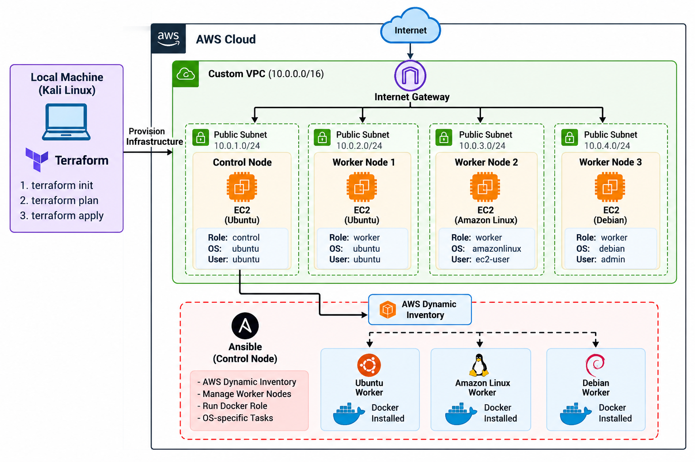

# Terraform + Ansible DevOps Project

## 📌 Overview

This project demonstrates an end-to-end **Infrastructure as Code (IaC) and Configuration Management** workflow using **Terraform, AWS, Ansible, Dynamic Inventory, and Docker**.

Terraform is used to provision the AWS infrastructure, while Ansible is used from a dedicated Control Node to configure the worker nodes.

The environment contains **4 EC2 instances**:

- 1 Ubuntu Control Node
- 1 Ubuntu Worker Node
- 1 Amazon Linux Worker Node
- 1 Debian Worker Node

Ansible uses **AWS Dynamic Inventory** to automatically discover EC2 instances based on AWS tags.

Docker is installed and configured on all worker nodes using an **Ansible Role with OS-specific tasks**.

---

## 🏗️ Architecture



### Architecture Flow

```text
                         AWS Cloud
                            |
                     Custom VPC
                      10.0.0.0/16
                            |
              +-------------+-------------+
              |                           |
        Control Node                 Worker Nodes
          Ubuntu                   +------+------+------+
          Ansible                  |      |      |
                                   |      |      |
                                Ubuntu Amazon  Debian
                                       Linux
                                   |      |      |
                                   +------+------+ 
                                          |
                                   AWS Dynamic Inventory
                                          |
                                       Ansible
                                          |
                                    Docker Role
                                          |
                         +----------------+----------------+
                         |                |                |
                         v                v                v
                      Ubuntu        Amazon Linux         Debian
                         |                |                |
                         +----------------+----------------+
                                          |
                                        Docker
```

---

## 🎯 Project Objectives

- Provision AWS infrastructure using Terraform.
- Create a custom VPC and public subnets.
- Configure Internet Gateway and route tables.
- Create security groups.
- Create IAM roles and instance profiles.
- Provision 4 EC2 instances.
- Configure one EC2 instance as an Ansible Control Node.
- Configure three EC2 instances as worker nodes.
- Use different Linux distributions on worker nodes.
- Configure Ansible on the Control Node.
- Use AWS Dynamic Inventory.
- Automatically discover EC2 instances using AWS tags.
- Create an Ansible Docker role.
- Use OS-specific Ansible task files.
- Install Docker on Ubuntu, Amazon Linux, and Debian.
- Start and enable the Docker service.
- Demonstrate Ansible idempotency.

---

# ☁️ AWS Infrastructure

Terraform provisions the following AWS resources:

```text
AWS
│
├── Custom VPC
│
├── Public Subnets
│
├── Internet Gateway
│
├── Route Tables
│
├── Security Groups
│
├── IAM Role
│
├── IAM Instance Profile
│
├── SSH Key Pair
│
└── EC2 Instances
    │
    ├── Control Node
    │   └── Ubuntu
    │
    ├── Worker Node 1
    │   └── Ubuntu
    │
    ├── Worker Node 2
    │   └── Amazon Linux
    │
    └── Worker Node 3
        └── Debian
```

---

# 🖥️ EC2 Configuration

| Instance | Operating System | Purpose |
|---|---|---|
| Control Node | Ubuntu | Ansible Control Node |
| Worker 1 | Ubuntu | Docker Worker |
| Worker 2 | Amazon Linux | Docker Worker |
| Worker 3 | Debian | Docker Worker |

The Control Node manages all three worker nodes through Ansible.

---

# 🏗️ Terraform

Terraform is used to provision the AWS infrastructure.

Terraform is executed initially from the local Kali Linux environment to create the AWS resources.

The resulting infrastructure is then managed from the Ansible Control Node.

## Terraform Modules

### VPC Module

Creates:

- Custom VPC
- Public subnets
- Internet Gateway
- Route tables
- Route table associations

### Security Group Module

Controls network access to the EC2 instances.

### EC2 Module

Creates the Control Node and Worker Nodes.

EC2 instances are tagged with information such as:

```text
Role
OS
AnsibleUser
```

These tags are consumed by Ansible Dynamic Inventory.

---

# 🔑 SSH Key Management

The private SSH key is used to connect from the Control Node to the worker nodes.

Example:

```bash
chmod 400 ansible-control.pem
```

Private keys must **never be committed to GitHub**.

They are excluded using `.gitignore`.

---

# 🤖 Ansible

Ansible is installed on the Ubuntu Control Node.

The Control Node manages the three worker nodes:

```text
                 Control Node
                    Ubuntu
                      |
                   Ansible
                      |
       +--------------+--------------+
       |              |              |
       v              v              v
    Ubuntu        Amazon Linux      Debian
    Worker          Worker          Worker
```

Terraform handles **infrastructure provisioning**.

Ansible handles **configuration management**.

---

# 📂 Ansible Structure

```text
ansible/
├── ansible.cfg
├── inventory/
│   └── aws_ec2.yml
├── group_vars/
│   ├── os_ubuntu.yml
│   ├── os_amazonlinux.yml
│   └── os_debian.yml
├── playbooks/
│   └── install-docker.yml
└── roles/
    └── docker/
        ├── defaults/
        │   └── main.yml
        ├── handlers/
        │   └── main.yml
        ├── tasks/
        │   ├── main.yml
        │   ├── ubuntu.yml
        │   ├── amazonlinux.yml
        │   └── debian.yml
        └── vars/
            └── main.yml
```

---

# 🔄 AWS Dynamic Inventory

This project uses the Ansible AWS EC2 Dynamic Inventory plugin:

```text
amazon.aws.aws_ec2
```

Inventory file:

```text
ansible/inventory/aws_ec2.yml
```

Instead of manually entering EC2 IP addresses, Ansible queries AWS and automatically discovers the instances.

The inventory creates groups based on EC2 tags.

Example:

```text
role_control
role_worker

os_ubuntu
os_amazonlinux
os_debian
```

---

# 🏷️ EC2 Tags

Example tags:

### Control Node

```text
Role = control
OS = ubuntu
AnsibleUser = ubuntu
```

### Ubuntu Worker

```text
Role = worker
OS = ubuntu
AnsibleUser = ubuntu
```

### Amazon Linux Worker

```text
Role = worker
OS = amazonlinux
AnsibleUser = ec2-user
```

### Debian Worker

```text
Role = worker
OS = debian
AnsibleUser = admin
```

These tags allow Dynamic Inventory to automatically create the appropriate Ansible groups and connection variables.

---

# 🔍 Check Dynamic Inventory

On the Control Node:

```bash
cd ~/Terraform-Ansible-Devops/ansible
```

Run:

```bash
ansible-inventory --graph
```

Example:

```text
@all:
  |--@aws_ec2:
  |  |--13.201.56.126
  |  |--3.6.126.149
  |  |--65.0.95.107
  |  |--13.204.64.177
  |
  |--@role_control:
  |  |--13.201.56.126
  |
  |--@role_worker:
  |  |--3.6.126.149
  |  |--65.0.95.107
  |  |--13.204.64.177
```

The IP addresses are discovered automatically from AWS.

---

# 🔐 OS-Specific SSH Users

Different Linux distributions use different default SSH usernames.

| Operating System | SSH User |
|---|---|
| Ubuntu | `ubuntu` |
| Amazon Linux | `ec2-user` |
| Debian | `admin` |

The Ansible inventory uses the EC2 tags to determine the appropriate SSH user.

---

# 🧪 Test Connectivity

Run:

```bash
ansible role_worker -m ping
```

Expected:

```text
SUCCESS => {
    "changed": false,
    "ping": "pong"
}
```

All three workers should return `pong`.

---

# 🐳 Docker Ansible Role

Docker configuration is implemented as a reusable Ansible Role:

```text
roles/docker/
```

The role contains OS-specific task files:

```text
roles/docker/tasks/
├── main.yml
├── ubuntu.yml
├── amazonlinux.yml
└── debian.yml
```

The role detects the operating system using Ansible facts and includes the appropriate task file.

```text
             Ansible Facts
                   |
                   v
             OS Detection
                   |
       +-----------+-----------+
       |           |           |
       v           v           v
    Ubuntu     Amazon Linux   Debian
       |           |           |
       v           v           v
 ubuntu.yml  amazonlinux.yml debian.yml
       |           |           |
       +-----------+-----------+
                   |
                   v
             Docker Installed
```

---

# ▶️ Install Docker

Run:

```bash
cd ~/Terraform-Ansible-Devops/ansible

ansible-playbook playbooks/install-docker.yml
```

The playbook targets:

```yaml
hosts: role_worker
```

Therefore, all worker nodes discovered by Dynamic Inventory are configured automatically.

---

# 🔍 Verify Docker

Check Docker versions:

```bash
ansible role_worker -a "docker --version"
```

Example:

```text
13.204.64.177 | CHANGED | rc=0 >>
Docker version 20.10.24

3.6.126.149 | CHANGED | rc=0 >>
Docker version 25.0.14

65.0.95.107 | CHANGED | rc=0 >>
Docker version 29.1.3
```

The exact Docker version may vary depending on the OS repositories.

---

# ⚙️ Verify Docker Service

Check whether Docker is running:

```bash
ansible role_worker -a "systemctl is-active docker" -b
```

Expected:

```text
active
```

Check whether Docker starts automatically:

```bash
ansible role_worker -a "systemctl is-enabled docker" -b
```

Expected:

```text
enabled
```

---

# 🔁 Ansible Idempotency

Running the playbook multiple times should not unnecessarily reinstall or modify Docker.

```bash
ansible-playbook playbooks/install-docker.yml
```

After the desired state has already been achieved, tasks should generally report:

```text
ok
```

rather than:

```text
changed
```

This demonstrates Ansible's idempotent configuration management.

---

# 🚀 Quick Start

## 1. Clone the Repository

```bash
git clone https://github.com/akshigour12/Terraform-Ansible-Devops.git
cd Terraform-Ansible-Devops
```

## 2. Initialize Terraform

```bash
terraform init
```

## 3. Validate Configuration

```bash
terraform validate
```

## 4. Review Infrastructure

```bash
terraform plan
```

## 5. Provision Infrastructure

```bash
terraform apply
```

## 6. Connect to the Control Node

After Terraform creates the Control Node:

```bash
ssh -i <your-key>.pem ubuntu@<control-node-public-ip>
```

## 7. Run Ansible

On the Control Node:

```bash
cd ~/Terraform-Ansible-Devops/ansible
```

Check inventory:

```bash
ansible-inventory --graph
```

Test workers:

```bash
ansible role_worker -m ping
```

Install/configure Docker:

```bash
ansible-playbook playbooks/install-docker.yml
```

Verify:

```bash
ansible role_worker -a "docker --version"
```

---

# 🔐 Security Practices

- Private SSH keys are excluded from Git.
- Terraform state files are excluded from Git.
- Sensitive `.tfvars` files are excluded from Git.
- EC2 instances use IAM roles where applicable.
- SSH access should be restricted to trusted IP addresses.
- Production environments should prefer AWS Systems Manager Session Manager over public SSH where appropriate.

---

# 🚫 .gitignore

Recommended `.gitignore`:

```gitignore
# Terraform
.terraform/
*.tfstate
*.tfstate.*
crash.log
crash.*.log

# Terraform variables
*.tfvars
*.tfvars.json

# SSH keys
*.pem
*.key
*.pub

# Ansible
*.retry
__pycache__/
*.pyc

# IDE
.vscode/
.idea/

# OS
.DS_Store
```

---

# 🧰 Useful Commands

### Terraform

```bash
terraform init
terraform validate
terraform plan
terraform apply
terraform destroy
```

### Ansible

```bash
ansible-inventory --graph
ansible role_worker -m ping
ansible-playbook playbooks/install-docker.yml
ansible role_worker -a "docker --version"
ansible role_worker -a "systemctl is-active docker" -b
ansible role_worker -a "systemctl is-enabled docker" -b
```

---

# 🔄 End-to-End Workflow

```text
Local Kali Linux
       |
       v
   Terraform
       |
       v
 AWS Infrastructure
       |
       v
  EC2 Instances
       |
       v
 Ansible Control Node
       |
       v
 AWS Dynamic Inventory
       |
       v
   role_worker
       |
       v
 Docker Ansible Role
       |
       v
 OS Detection
       |
   +---+---+---+
   |       |   |
 Ubuntu Amazon Debian
   |       |   |
   +---+---+---+
       |
       v
Docker Installed
       |
       v
Docker Service Active
       |
       v
Docker Enabled
```

---

# 📁 Repository Structure

The GitHub repository contains the Terraform infrastructure code and the Ansible configuration-management code.

```text
Terraform-Ansible-Devops/
│
├── .gitignore
├── README.md
│
├── main.tf
├── providers.tf
├── variables.tf
├── outputs.tf
├── versions.tf
│
├── modules/
│   ├── vpc/
│   │   ├── main.tf
│   │   ├── variables.tf
│   │   └── outputs.tf
│   │
│   ├── security-groups/
│   │   ├── main.tf
│   │   ├── variables.tf
│   │   └── outputs.tf
│   │
│   └── ec2/
│       ├── main.tf
│       ├── variables.tf
│       └── outputs.tf
│
└── ansible/
    │
    ├── ansible.cfg
    │
    ├── inventory/
    │   └── aws_ec2.yml
    │
    ├── group_vars/
    │   ├── os_ubuntu.yml
    │   ├── os_amazonlinux.yml
    │   └── os_debian.yml
    │
    ├── playbooks/
    │   └── install-docker.yml
    │
    └── roles/
        └── docker/
            │
            ├── defaults/
            │   └── main.yml
            │
            ├── handlers/
            │   └── main.yml
            │
            ├── tasks/
            │   ├── main.yml
            │   ├── ubuntu.yml
            │   ├── amazonlinux.yml
            │   └── debian.yml
            │
            └── vars/
                └── main.yml
```

---

# 📚 Key Learning Outcomes

This project demonstrates practical experience with:

- Infrastructure as Code using Terraform
- Terraform Modules
- AWS VPC Networking
- AWS EC2
- AWS IAM
- Security Groups
- SSH Key Management
- Ansible Control Node
- AWS Dynamic Inventory
- `amazon.aws.aws_ec2`
- Ansible Groups
- Ansible Variables
- Ansible Roles
- OS-specific Task Execution
- Docker Automation
- Linux Administration
- Configuration Management
- Idempotent Automation
- Git and GitHub
- Multi-OS Infrastructure Management

---

# 👩‍💻 Author

**Akshita Gour**

LinkedIn: https://www.linkedin.com/in/akshita-g-6a24871a4/
